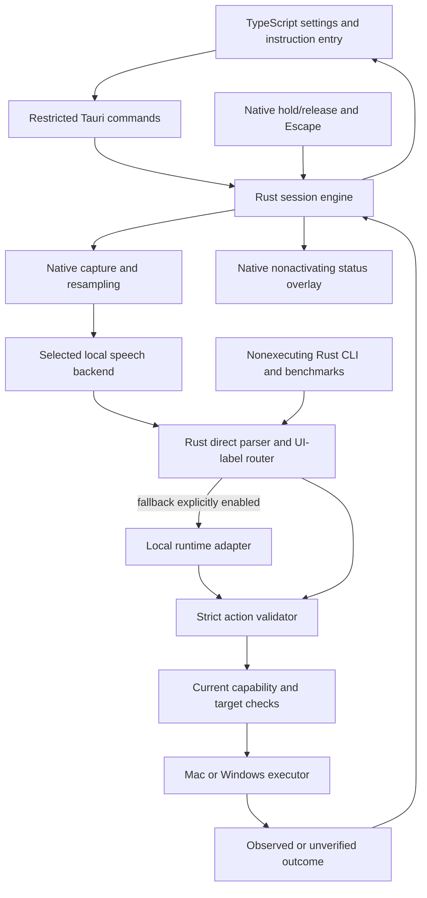
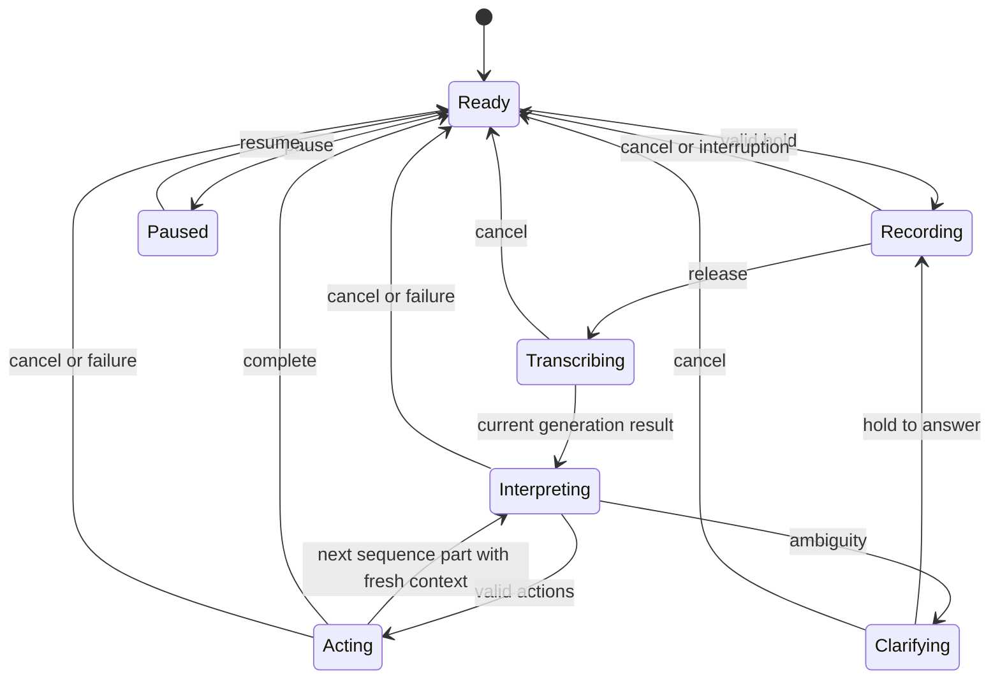
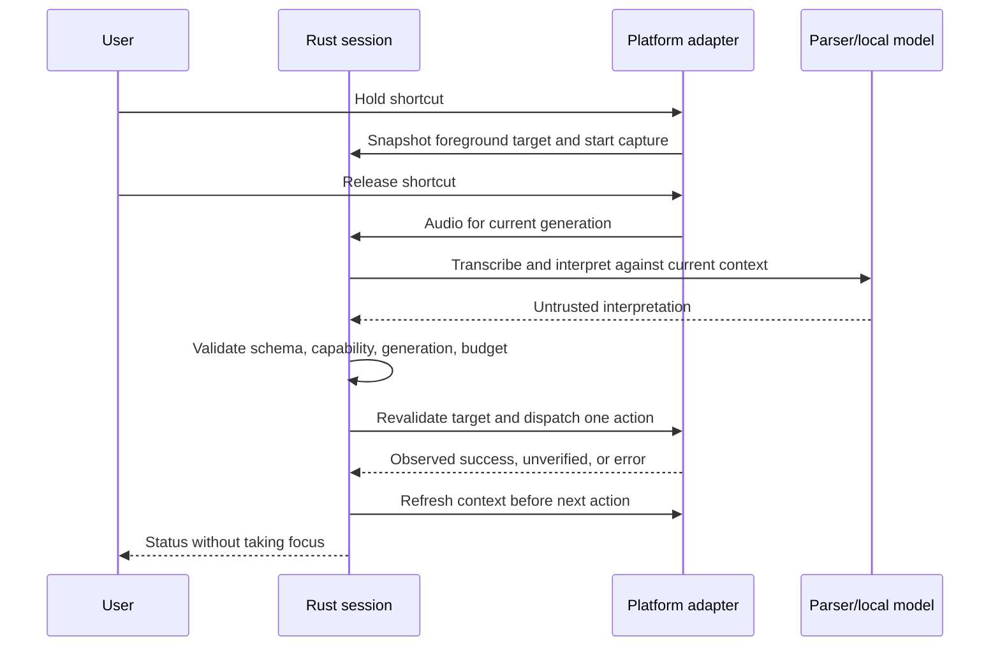

# FnPilot Cross-Platform Migration and OSS Readiness - Plan

## Goal Capsule

- **Objective:** People on macOS and Windows can install and use FnPilot locally, and outside contributors can build, test, and improve it without the maintainer's machine or credentials.
- **Means:** Shared Rust engine, Tauri desktop shell, and TypeScript interface (KTD1).
- **Authority:** The confirmed macOS/Windows scope and Product Contract govern behavior; the Planning Contract governs implementation choices.
- **Execution profile:** Incremental replacement alongside the existing Swift app, with characterization before porting and native hardware checks before cutover.
- **Stop conditions:** Do not replace the existing app while parity or safety gates fail; do not publish source with unresolved ownership or secret exposure; do not label unsigned artifacts as official signed releases.
- **Delivery responsibility:** Contributors can implement and validate units independently. The maintainer supplies license approval, release identities, hardware acceptance, and publication decisions before the corresponding release gate.

---

## Product Contract

### Summary

Migrate FnPilot to a shared desktop architecture while preserving its local voice-control behavior and cautious action execution.
Deliver macOS and Windows support first, with a public contributor workflow, documented platform limits, reproducible build instructions, and verified distribution artifacts.

### Problem Frame

The current application targets macOS 14 and Apple Silicon, uses Apple frameworks throughout its desktop integration, and requires a local Apple signing identity in its packaging path.
A contributor on Windows cannot build or exercise the whole application, and there is no root project license or public contribution workflow in the tracked file inventory.
The architecture limits reach and contribution even though the parser, validator, runtime adapters, and fixture corpus already provide reusable behavior.

Replacing Swift does not itself prove lower latency or memory use.
Speech recognition and model inference are substantial costs, and changing their backend can regress Mac performance.
The migration therefore needs measured efficiency and preserved behavior rather than a language-based speed claim.

### Key Decisions

- **macOS and Windows first.** Governs R1. (session-settled: user-directed — chosen over including full Linux support in the initial migration: establish two usable desktop implementations first.)
- **Incremental migration with OSS preparation.** Governs R2, R14, R15. (session-settled: user-approved — chosen over replacing the current app before parity: preserve a usable Mac baseline while preparing contributor access.)

### Requirements

**Platforms and existing behavior**

- R1. Initially support macOS and Windows desktop use, with platform capability limits visible before unsupported actions execute.
- R2. Preserve working Mac commands and documented distinctions, including close versus quit, video versus window full screen, exact accessible labels, and literal dictated text.
- R3. Preserve hold-to-talk, release-to-act, Escape cancellation, pause, sleep/wake interruption, original-app targeting, and clarification continuation.
- R4. Provide settings, a tray/menu-bar entry, a compact nonactivating status overlay, permission/setup diagnostics, runtime selection, and optional launch at login.
- R5. Preserve the CLI's nonexecuting interpretation contract and machine-readable output; diagnostics and benchmarks must never drive desktop actions.

**Execution integrity and privacy**

- R6. Every interpreted action must pass strict validation and current-platform capability checks before execution; unknown fields, invalid arguments, stale targets, and partial model responses must fail closed.
- R7. Preserve the existing aggregate 20-action command budget, stop-on-error behavior, fresh context after target changes, and cancellation checks between actions.
- R8. Keep experimental model actions off by default, and retain explicit user opt-in independently of runtime connection health.
- R9. Record audio only during an active hold-to-talk session, keep captured audio transient, and avoid persistent transcripts, accessibility text, or raw inference payload logs by default.
- R10. Keep inference local, with no automatic cloud fallback, model substitution, or per-command download; model acquisition must be an explicit setup action.
- R11. Report observed success separately from an action merely sent, preserve native save dialogs, and refuse protected or inaccessible targets without bypassing OS controls.

**Portability, efficiency, and OSS**

- R12. Both desktop apps must share one parser, validator, model-protocol implementation, and session state machine in Rust; native adapters own OS-specific integration.
- R13. Publish reproducible measurements for transcription, routing, action execution, startup, idle overhead, and total process memory rather than claiming the chosen language is faster.
- R14. A clean contributor checkout must build and run core tests on macOS and Windows without signing secrets, model downloads, paid accounts, or a running local model server.
- R15. Before public OSS launch, include an approved project license, dependency/model attribution, contribution and security-reporting instructions, and an audited publication snapshot.
- R16. Official installable releases must pass platform signing, installation, update, and uninstall checks; credentials stay outside the repository and untrusted contribution jobs.
- R17. Import existing Mac preferences without deleting the Swift app's data or silently enabling execution settings, and provide a documented rollback path.

### Success Criteria

These are acceptance budgets to validate during implementation, not measurements already achieved.

| ID | Acceptance signal |
|---|---|
| SC1 | All migrated deterministic parser, validation, cancellation, and context regression cases pass; the original 100 text fixtures remain immutable and every output difference is explained. |
| SC2 | On the same Mac, the warm file-audio-to-plan p95 is no more than 10% slower than a freshly recorded Swift baseline using comparable model size and decoding policy across three paired runs. |
| SC3 | On the Mac audio corpus, command exact-match does not fall and overall word-error rate increases by no more than 2 absolute percentage points; otherwise retain the existing Mac recognizer behind the Rust interface. |
| SC4 | With settings closed and models unloaded, app-owned processes including attributed WebViews use at most 150 MiB combined resident memory and average at most 1% of one logical CPU over a five-minute idle run on each declared reference machine. |
| SC5 | After models are loaded, Windows warm release-to-first-action-dispatch p95 is at most 3 seconds for the frozen 1–5 second explicit-command audio subset on the declared CPU-only Windows reference machine. Report action verification time separately. |
| SC6 | A new contributor on each target OS follows the documented quickstart, runs the mock UI and core tests, and produces a local development build without maintainer assistance or secrets. |
| SC7 | A signed release candidate passes the supported capability matrix on native hardware and an upgrade from the preceding candidate; source-publication readiness is recorded separately from binary readiness. |

U1 records hardware, corpus hashes, measurement definitions, and current baseline outputs before changes.
If a budget cannot be met, optimize or explicitly revise the release claim with maintainer agreement; a failed budget is not a passing migration.
Model accuracy qualification remains separate from these migration criteria and does not change R8.

### Scope Boundaries

The first binary targets are macOS 14+ on Apple Silicon and Windows 11 x64.
These are implementation defaults chosen to preserve the current Mac minimum and establish a bounded Windows hardware baseline; U2 verifies the selected dependency versions support them.
Windows runs as an ordinary user and does not automate elevated applications, UAC prompts, login screens, or secure desktops.

The initial language remains English.
The interface should accept Unicode and use externalized user-facing strings so later localization does not require rewriting the engine.

#### Deferred to Follow-Up Work

- Linux desktop execution, including explicit X11/Wayland permission and automation research; pure Rust core portability can be exercised on Linux without advertising desktop support.
- Intel Mac and Windows ARM64 installers until native hardware and runtime qualification exist.
- Multilingual speech and UI localization, mobile clients, app-store submissions, automatic updates, plugin marketplaces, and remote-control APIs.

#### Considered and Not Built

- A mandatory separate daemon or OS service: there is one app-owned session engine and no need for background execution after app exit.
- A new executing CLI or MCP server: preserve R5 and avoid adding an unauthenticated execution surface during migration.
- A frontend framework migration beyond TypeScript: the settings and status views do not yet justify React or another component runtime.
- Screenshot recognition, arbitrary shell/AppleScript/PowerShell actions, privilege escalation, and force quitting to bypass save dialogs: these broaden existing execution authority.
- Database infrastructure, cloud accounts, telemetry collection, and automatic error uploads: the current preferences and local diagnostic workflow do not require them.

### Acceptance Examples

- AE1. Covers R2, R7: “Open TextEdit and type Open Chrome then quit nothing!” opens the target and types the remaining text literally, without running embedded commands or pressing Return.
- AE2. Covers R3, R7: Escape during transcription invalidates the session; a later completed transcript cannot execute or replace the status of a newer session.
- AE3. Covers R6, R11: Two visible Save buttons cause clarification; an incomplete scan or changed target cannot turn either button into a safe unique match.
- AE4. Covers R1, R11: A Windows request to type into an elevated app reports the limitation without retrying as administrator or typing into another window.
- AE5. Covers R8, R17: Importing preferences never turns on model actions that were disabled, and a missing field defaults to disabled.
- AE6. Covers R14: A Windows contributor without microphone hardware or downloaded weights can build the CLI, run all mock engine tests, and open the mock settings UI.
- AE7. Covers R3, R4: The listening pill appears over the foreground app without becoming the foreground window; typing goes only to the validated target.

---

## Planning Contract

### Current Repository Evidence

| Existing area | Evidence | Migration consequence |
|---|---|---|
| Build | `Package.swift` targets macOS 14 and pins WhisperKit 0.9.4. | A cross-platform shell alone cannot port desktop integration or speech. |
| Pure command behavior | `Sources/FnPilotCore/Commands.swift`, `DirectUIParser.swift`, `Capabilities.swift`, `CommandRunner.swift`, `HotkeyState.swift`. | Port these behaviors before changing grammar or action meaning. |
| Inference and validation | `Sources/FnPilotCore/Inference.swift` contains strict schemas, four output modes, loopback rules, context compaction, and response checks. | Preserve adapter-specific request details and fail-closed decoding. |
| Session orchestration | `Sources/FnPilotApp/AppController.swift` owns task cancellation, recording generations, clarification, targeting, and preferences. | Move orchestration into Rust rather than into TypeScript components. |
| Native Mac integration | `Sources/FnPilotApp/MacExecutor.swift`, `HotkeyMonitor.swift`, `Speech.swift`, `StatusOverlay.swift`. | Isolate native behavior and retain useful Apple code during transition. |
| Runtime packaging | `Sources/FnPilotApp/ManagedRuntime.swift`, `scripts/build-runtime.sh`, `scripts/package-runtime.py`. | Preserve pinned helper provenance while adding Windows paths and process handling. |
| Signing identity | `Resources/Info.plist` uses `com.fnpilot.mac`; `scripts/sign-app.py` requires local signing configuration. | Keep developer and official release workflows distinct and explicitly test permission continuity. |
| Validation | `Resources/commands100.json`, `Tests/FnPilotCoreTests/`, `Tests/FnPilotAppTests/`, `VALIDATION.md`. | Reuse regression intent and distinguish headless proof from live desktop proof. |
| Model reliability | `VALIDATION.md` records 84/100 and 89/100 parser-plus-model results for the two tested models. | Preserve R8; framework migration cannot qualify a model. |
| OSS inventory | No root `LICENSE`, `CONTRIBUTING.md`, `SECURITY.md`, or tracked CI workflow was found; `THIRD_PARTY_NOTICES.txt` exists. | Add project ownership/licensing and community infrastructure, then audit notices. |

At planning time, `Sources/FnPilotApp/Speech.swift` and `main.swift` have local modifications; active untracked work includes `Sources/FnPilotApp/SpeechBenchmark.swift`, `Sources/FnPilotCore/SpeechAudio.swift`, `Tests/FnPilotCoreTests/SpeechAudioTests.swift`, `scripts/benchmark-speech.py`, and `scripts/download-whisper-turbo.py`.
Treat them as active user work, preserve them, and coordinate the baseline with their final behavior.
Their presence is not evidence that the new speech benchmark has completed or passed.
`VALIDATION.md` contains historical checks and explicitly incomplete GUI checks; do not present its old test count as a fresh test run.

### Key Technical Decisions

- KTD1. **Rust workspace with Tauri 2 and Vite/TypeScript.** Keep domain crates independent of Tauri, and start with small framework-free TypeScript views. (session-settled: user-directed — chosen over a Swift-only app, Flutter, and Electron: support broader desktop contribution with a native shared engine.) Advances R12 and R14. Pin exact compatible versions and commit lockfiles in U2; do not assume that a Tauri minor release or target architecture is supported without building it.
- KTD2. **In-process native adapters.** Expose a platform abstraction for target snapshots, control discovery, execution outcomes, hotkey events, audio capture, permissions, and overlay lifecycle. Rust owns sessions; macOS initially links extracted Swift/Objective-C functionality through a narrow C ABI, while Windows uses Microsoft's `windows` crate. This avoids a second Mac app process owning microphone/input permissions. Native objects remain on their required thread; only owned values cross the boundary. Advances R1–R4 and R12. [Rust for Windows](https://github.com/microsoft/windows-rs).
- KTD3. **Rust is the only execution authority.** The TypeScript interface requests named application operations such as submit instruction, cancel, pause, configure, load model, and diagnose; it never sends trusted prevalidated action arrays. Each invocation is revalidated in Rust and restricted by caller/window permissions. Explicitly register custom command permissions in the Tauri application manifest, since ordinary registered application commands are otherwise broadly callable by app WebViews. Bundle UI locally, deny remote navigation and remote IPC access, and give the overlay no execution permission. Set a production Content Security Policy that disallows remote scripts and eval; render transcripts, control labels, model messages, and diagnostics as text rather than executable HTML. Advances R6, R9, R10. [Tauri capabilities](https://v2.tauri.app/security/capabilities/).
- KTD4. **Separate serialized plans from live OS identities.** Keep the existing action/status JSON and CLI exit meanings for compatibility. Use platform-qualified app identities internally and adapters for legacy `bundleID` fixture fields; do not pretend Windows has bundle identifiers. Live targets also include process-start identity and window/control generation. Bounded discovery records whether a scan is complete, and a capability-filtered model tool list must still be validated before dispatch. Advances R5–R7 and R11.
- KTD5. **One cancellable session state machine.** Each recording/instruction has a generation token; only the current token can commit transcript, status, clarification, or execution work. Execution is serial and native calls are bounded; a cancellation prevents the next action but cannot undo an already dispatched OS action. Clarification captures its original validated target and remaining steps, and target changes invalidate its control snapshot. Advances R3 and R7.
- KTD6. **Portable speech with a measured Mac fallback.** Use pinned `whisper.cpp` through its C API, wrapped in a small Rust speech module, as the Windows backend and preferred shared backend. Keep the existing WhisperKit recognizer available only on Mac until SC2/SC3 pass. Load one selected speech backend at a time and reuse its model between recordings; never spawn a recognizer per command. Audio capture stays native initially: AVFoundation on Mac and WASAPI on Windows, converted to bounded 16 kHz mono float samples. Core ML/Metal configurations are benchmark candidates, not speed guarantees. Advances R9, R10, R13. [whisper.cpp](https://github.com/ggml-org/whisper.cpp).
- KTD7. **Preserve local runtime protocols and helper ownership.** Port Ollama and OpenAI-compatible request/response paths with their four output modes. Reject redirects, nonloopback resolved destinations, proxy routing, and remote Ollama metadata; explicitly document that an independently configured local proxy's upstream behavior cannot be guaranteed by endpoint checks. Bundle a pinned `llama-server` sidecar, launched only by Rust using argument arrays. Track its actual child process, bounded readiness, model/port ownership, and process-tree shutdown on each OS. Treat an occupied port as an error, not permission to adopt another server. Advances R6, R8, R10. [Tauri external binaries](https://v2.tauri.app/develop/sidecar/).
- KTD8. **Native shortcut semantics and nonactivating overlay.** Keep Mac Fn event-tap behavior rather than relying on generic shortcut support for Fn. On Windows use a configurable ordinary key/chord, initially Right Ctrl hold-to-talk, with explicit keydown/keyup and chord cancellation. Some keyboards do not expose Fn to applications. Use a native nonactivating overlay host on each platform; settings use TypeScript, and overlay presentation may remain native where WebView focus or memory behavior fails SC4/AE7. Preserve the current compact no-transcript appearance and dismissal timings. Advances R3 and R4.
- KTD9. **Versioned local preferences with a one-way import.** Store new settings as an atomically written, schema-versioned JSON file under OS app-data locations. On first Mac launch, read only known legacy UserDefaults keys, validate them, preview/import once, and leave their source intact. Core ML speech files are not compatible `whisper.cpp` weights; reuse a model only after verifying its format and manifest. Use a separate development app identifier and separate config directory. Advances R10, R14, R17.
- KTD10. **Public source and official binaries have separate gates.** Propose MIT for FnPilot-owned code, subject to maintainer/rights-holder approval before adding the license or publishing source; third-party terms stay attached to their actual dependencies and weights. Model and benchmark-data redistribution require their own inventory entries. Source can open with honest preview limitations before official binaries are ready. No CLA service is needed initially; contributions follow the repository's approved license with documented provenance expectations. Advances R15 and R16.
- KTD11. **Contributor CI is secret-free; release CI is isolated.** All pull requests run locked dependency installation, formatting, type checks, Rust tests, mocked integration, and native target builds without credentials. Protected release jobs alone receive signing credentials, and they rebuild the reviewed tag rather than promoting executable artifacts from untrusted PR jobs. Actions are commit-pinned with minimal permissions. Advances R14–R16.
- KTD12. **Benchmark the whole application.** Attribute app, WebView, speech, and model-server resource use separately and in total. Compare fixed clips, model hashes, settings, and hardware across paired runs, with cold start separate from steady state. Use synthetic/consented public fixtures and publish sanitized results; never collect user voice by default. Advances R9 and R13.

### High-Level Technical Design







Model setup is a separate lifecycle: missing artifact → explicit user consent → download into a temporary file → size/hash verification → atomic install → selected backend load → ready.
Cancellation or verification failure leaves no artifact eligible for execution.
The manifest records artifact format, upstream revision, checksum, license reference, size, and applicable architecture/backend.
Do not silently convert, delete, or redownload existing model caches.

### Proposed Output Structure

The following paths are planned additions, not files that already exist.
Keep `Sources/`, `Tests/`, `Package.swift`, and the current build scripts at their current paths until U12 removes only superseded application code.

```text
Cargo.toml / Cargo.lock / rust-toolchain.toml
package.json / package-lock.json
crates/fnpilot-core/           parser, validator, context, session contracts
crates/fnpilot-runtime/        local inference protocols and owned helper lifecycle
crates/fnpilot-speech/         whisper.cpp wrapper and model setup
crates/fnpilot-platform/       interface and platform-specific modules
crates/fnpilot-cli/            nonexecuting CLI
crates/fnpilot-bench/          headless corpus evaluation
native/macos/                 extracted in-process Apple bridge and optional WhisperKit
apps/desktop/src/             TypeScript settings, state binding, mock mode
apps/desktop/src-tauri/        Tauri host, command ACLs, bundling configuration
fixtures/                     contract cases, platform cases, speech manifests
scripts/                      portable build, benchmark, and release verification helpers
.github/workflows/            checks, native builds, protected releases
.github/ISSUE_TEMPLATE/       bug and feature templates
docs/                         architecture, platform support, migration, contributing detail
```

### Platform Capability Policy

A runtime capability is computed from OS, device, permission state, target app, and discovered control patterns.
An adapter must not advertise an action that it cannot implement with the promised meaning.
Windows release acceptance requires implemented ordinary-user core commands; limitations below must remain explicit rather than being counted as successful execution.

| Capability | macOS plan | Windows plan |
|---|---|---|
| Hold-to-talk | Preserve physical Fn and normal Fn chords. | Right Ctrl default with configurable hold key/chord; no promise of hardware Fn. |
| App launch/focus | Existing app discovery and bundle targeting. | Resolve installed desktop/packaged apps to explicit launch identities; disambiguate collisions and verify foreground change. |
| Literal typing and scroll | Preserve Unicode event injection and focus checks. | Unicode input/UI Automation where appropriate, with integrity-level and foreground checks. |
| Close/quit | Preserve separate window close and graceful app termination. | Window close and graceful app-close requests; multiwindow apps need explicit outcome handling, never forced termination. |
| Minimize/maximize/restore | Preserve chosen-window and saved-frame semantics. | Native window state APIs with original placement restoration. |
| Exact-label click/field | Accessibility with bounded complete scans. | UI Automation Invoke/Value/Scroll patterns with password-field exclusion and fresh runtime identity. |
| Window/video full screen | Preserve existing distinctions. | Target-app UI Automation patterns only when discoverable; do not equate maximize or an unconditional F11 with full screen. |
| Play/pause | Preserve app-scoped accessible media controls. | Prefer app-scoped UI Automation controls; never broadcast a media key and claim the named app changed. |
| Volume/mute | CoreAudio, only supported outputs. | Core Audio endpoint volume, with readback. |
| Built-in brightness | Retain documented private DisplayServices dependency and availability checks during migration. | Supported built-in display control only; absent hardware/API support reports unsupported. |
| External monitor brightness | Remains unsupported. | Remains unsupported in the initial release. |

Windows UI Automation and input injection cross privilege boundaries; a normal-user process cannot promise automation of higher-integrity applications.
Use failure-aware outcomes rather than automatic elevation. [Microsoft SendInput](https://learn.microsoft.com/en-us/windows/win32/api/winuser/nf-winuser-sendinput), [UI Automation security](https://learn.microsoft.com/en-us/windows/win32/winauto/uiauto-securityoverview).

### Sequencing and Milestone Gates

| Milestone | Units | Exit gate |
|---|---|---|
| M0: Preserve and characterize | U1 | Frozen behavior and fresh measurement baseline; user edits preserved. |
| M1: Establish portable foundation | U2, U3 | Secret-free native builds and Rust core/CLI parity. |
| M2: Prove native integrations early | U4, U5, U6 | Each OS demonstrates a real shortcut → capture → transcription → open Calculator flow and Escape cancellation in a safe test environment. |
| M3: Replace application orchestration | U7, U8, U9 | Runtime, settings, clarification, nonactivating overlay, and migration behave through the Rust engine. |
| M4: Open the source | U10 | Approved license/provenance, audited publication snapshot, contributor docs and CI; label platform maturity honestly. |
| M5: Qualify public binaries and cut over | U11, U12 | Signed install/upgrade verification, capability acceptance, and SC1–SC7 evidence. |

U10 can start after U2 and continue while feature work proceeds; source publication requires its gate but does not require pretending M5 is complete.
M2 precedes polish so Windows feasibility and native focus behavior are proven before the old app is retired.
The implementation should split units into reviewable changes without creating a long-lived duplicate product branch.

### Risks, Dependencies, and Deferred Decisions

| Risk or prerequisite | Decision and point of resolution |
|---|---|
| WhisperKit/Core ML outperforms the portable backend on Mac. | KTD6 and SC2/SC3 retain the Mac backend when required; benchmark before deleting it. |
| Swift/Rust boundary or OS thread affinity corrupts object lifetime. | U4 uses opaque owned handles, explicit destruction, bounded callbacks, and main-thread confinement; no native object serialization. |
| UI Automation providers hang or controls disappear. | U5 uses a dedicated COM worker, bounded requests, and generation invalidation; timeout stops the session and never triggers a substitute action. |
| Nonactivating overlay fails in Tauri/WebView. | KTD8 chooses a native overlay host and makes live focus verification an M2/M3 gate. |
| macOS permission continuity changes with host/signing identity. | U11 measures running-app attribution and same-signer updates; planned Apple Development → Developer ID transition may require one-time permission renewal. |
| Windows GPU support varies. | CPU-only Windows reference support is mandatory; GPU builds are optional until separately qualified and correctly packaged. |
| License/copyright authority is not established. | Maintainer confirms rights and MIT proposal before U10's publication step; engine/scaffold work can proceed earlier. |
| Signing accounts/certificates or Windows hardware are unavailable. | They block the relevant official-binary/native-hardware gate, not mock tests or source preparation; U11 documents the exact missing prerequisite. |
| Old benchmark/audio assets have redistribution restrictions. | U10 records licenses and keeps unapproved clips/generated voices out of release/source artifacts; use manifests and retrieval instructions where permitted. |
| Exact native dependency/toolchain compatibility is unknown today. | U2 pins versions after native build proof; U6/U7 pin upstream engine commits and manifests before distribution. No floating runtime downloads. |

### System-Wide Impact

The Rust core becomes the shared authority for UI-submitted and voice-submitted instructions.
The CLI retains explicit fixture context and cannot inspect or control the live desktop under R5; this boundary is intentional and documented.

Settings and the native session subscribe to one backend state source, preventing UI recreation from starting another recorder or server.
Audio and accessibility snapshots expire with their sessions.
Diagnostics expose permission/backend/health states with redacted paths and no user content by default.

The release changes application packaging and potentially its designated signing requirement.
Preserving `com.fnpilot.mac` alone does not establish permission retention; first use a separate development identifier and replace the installed app only after native acceptance.

---

## Implementation Units

| Unit | Change | Primary paths | Depends on |
|---|---|---|---|
| U1 | Freeze contracts and baseline | `fixtures/`, `docs/migration-baseline.md` | None |
| U2 | Rust/Tauri scaffold and contributor checks | `Cargo.toml`, `apps/desktop/`, `.github/workflows/checks.yml` | U1 |
| U3 | Port core behavior and nonexecuting CLI | `crates/fnpilot-core/`, `crates/fnpilot-cli/` | U1, U2 |
| U4 | Extract Mac native adapter | `native/macos/`, `crates/fnpilot-platform/src/macos/` | U2, U3 |
| U5 | Implement Windows native adapter | `crates/fnpilot-platform/src/windows/` | U2, U3 |
| U6 | Portable speech and model setup | `crates/fnpilot-speech/`, `fixtures/speech/` | U4, U5 |
| U7 | Port local runtime adapters and helper | `crates/fnpilot-runtime/`, `scripts/build-runtime.*` | U3 |
| U8 | Rust session orchestration and desktop UI | `crates/fnpilot-core/src/session.rs`, `apps/desktop/` | U4–U7 |
| U9 | Preferences import and diagnostics | `apps/desktop/src-tauri/src/settings.rs`, `docs/migration.md` | U8 |
| U10 | OSS licensing, provenance, and contributor access | `LICENSE`, `CONTRIBUTING.md`, `SECURITY.md`, `.github/` | U2; finalize against U3–U9 |
| U11 | Native packaging and protected releases | `.github/workflows/release.yml`, `scripts/release/` | U9, U10 |
| U12 | Parity, performance, and controlled cutover | `crates/fnpilot-bench/`, `docs/validation/`, legacy sources | U11 |

### U1. Freeze behavior and record a fresh baseline

**Goal:** Create a trusted oracle for migration without changing the app's behavior.

**Requirements:** R2, R3, R5–R8, R13; SC1–SC5.

**Dependencies:** None.

**Files:** Read `Sources/`, `Tests/`, `Resources/commands100.json`, `VALIDATION.md`, and active speech benchmark work. Add `docs/migration-baseline.md`, `fixtures/contracts/manifest.json`, `fixtures/contracts/parser.json`, `fixtures/contracts/validation.json`, `fixtures/contracts/session.json`, `fixtures/contracts/runtime-responses.json`, and `scripts/capture-baseline.py`.

**Approach:** Capture deterministic inputs/outputs and CLI exit behavior independently of model nondeterminism. Keep the original corpus unchanged; record hash and parser-first routing behavior, including failures. Select and record the actual Mac and Windows reference hardware and a redistributable speech manifest for SC2–SC5. Annotate current GUI checks as observed, unverified, or newly measured.

**Patterns:** Existing Swift regression tests, headless CLI, benchmark report fields, and the active `Sources/FnPilotCore/SpeechAudio.swift` preparation rules.

**Execution note:** Characterize before porting; coordinate with the existing speech benchmark edits rather than replacing them.

**Test scenarios:**

1. Covers AE1: capture literal punctuation and embedded command words unchanged.
2. Capture ambiguous labels, incomplete scans, invalid numeric values, and over-budget sequences with their rejection outcomes.
3. Capture all CLI result statuses and exit codes, including duplicate flags and rejected `--execute`.
4. Record cancellation followed by a late transcript as a session trace with no execution.
5. Reject a baseline report whose corpus hash, backend configuration, or repetition set is incomplete.

**Verification:** Fixtures have provenance, hashes, expected outcomes, and no private user content; the baseline report distinguishes historical data from fresh measurements. Add fixture-capture regression tests at `scripts/tests/test_capture_baseline.py` for report validation.

### U2. Establish the workspace, shell, and secret-free checks

**Goal:** Let Mac and Windows contributors build the same desktop skeleton and test pure logic without models.

**Requirements:** R4, R12, R14; KTD1, KTD3, KTD11.

**Dependencies:** U1.

**Files:** Add root `Cargo.toml`, `Cargo.lock`, `rust-toolchain.toml`, `package.json`, `package-lock.json`, `.node-version`, `.editorconfig`; `apps/desktop/package.json`, `apps/desktop/vite.config.ts`, `apps/desktop/tsconfig.json`, `apps/desktop/src/main.ts`, `apps/desktop/src-tauri/Cargo.toml`, `apps/desktop/src-tauri/build.rs`, `apps/desktop/src-tauri/src/{main,lib}.rs`, `apps/desktop/src-tauri/tauri.conf.json`, `apps/desktop/src-tauri/capabilities/settings.json`, `apps/desktop/src-tauri/permissions/app.toml`; `.github/workflows/checks.yml`, `docs/development.md`, and `apps/desktop/src/tests/mock-mode.test.ts`. Extend `.gitignore` for Rust, Node, native artifacts, and local settings.

**Approach:** Create the minimal Tauri settings window and fake backend mode. Pin a compatible stable Rust toolchain, Node LTS, Tauri 2 dependencies, and npm version; prove target minimums before documenting them. Start cross-OS checks here so later units cannot introduce a Mac-only build assumption.

**Test scenarios:**

1. Covers AE6: mock mode opens with no microphone, model, certificate, or local model server.
2. Windows native builds exclude Swift/macOS modules and Mac native builds exclude Windows modules.
3. Frozen installs reproduce dependencies from the committed lockfiles.
4. A WebView without the named app capability cannot invoke a privileged custom command.

**Verification:** Both OS jobs build the scaffold and run their applicable checks with no credentials; development identity and production identity remain separate.

### U3. Port the parser, validator, routing, and CLI

**Goal:** Establish shared command behavior before native execution is switched over.

**Requirements:** R2, R5–R8, R12; KTD4, KTD5; SC1.

**Dependencies:** U1, U2.

**Files:** Add `crates/fnpilot-core/src/{action,parser,direct_ui,capabilities,context,runner,hotkey,session,state}.rs`, crate manifests and exports; `crates/fnpilot-core/tests/{contracts,validation,routing,cancellation}.rs`; `crates/fnpilot-platform/src/{lib,types}.rs`; `crates/fnpilot-cli/src/main.rs`, `crates/fnpilot-cli/tests/cli_contract.rs`; `fixtures/platforms/windows.json`.

**Approach:** Port semantics rather than translating regex syntax mechanically; Swift's regex support differs from typical Rust regex crates. Preserve original action strings/statuses and strict per-action unknown-field rejection. Keep platform-neutral identities internal while importing old fixture context explicitly. Establish the shared platform interfaces and minimal generation-aware direct-command session here so U4–U6 can demonstrate the M2 flow without a throwaway execution path. U8 extends this same session with clarification, inference, preferences, and full UI state. CLI runtime commands can use a stub adapter until U7 links the real one.

**Patterns:** `Commands.swift`, `DirectUIParser.swift`, `Inference.swift`, `CommandRunner.swift`, `HotkeyState.swift`, and existing XCTest cases.

**Test scenarios:**

1. Covers AE1: every dictation verb and compound separator preserves literal payloads.
2. Covers AE3: duplicate, missing, stale, or incompletely scanned controls never execute as a unique target.
3. A 21st aggregate action is rejected even when split among multiple sequence parts.
4. Unknown action fields, NaN/infinite/out-of-range percentages, unrelated tools, and action-bearing clarification are rejected.
5. A target switch clears old controls and a failing/cancelled step prevents later actions.
6. CLI stdout stays parseable JSON for results, errors stay on stderr, and R5 exit behavior matches U1 fixtures.

**Verification:** Deterministic Swift-versus-Rust contracts match, with separately reviewed cases for corrected preexisting behavior; Windows fixtures use real platform semantics without rewriting the original Mac corpus.

### U4. Extract the in-process macOS adapter

**Goal:** Preserve Mac integration while moving execution ownership to Rust.

**Requirements:** R1–R4, R6, R7, R11, R12; KTD2, KTD8.

**Dependencies:** U2, U3.

**Files:** Add `crates/fnpilot-platform/src/macos/{mod,bridge}.rs`, `crates/fnpilot-platform/tests/macos_contract.rs`; `native/macos/Package.swift`, `native/macos/Sources/FnPilotBridge/{Bridge,Executor,Hotkey,Audio,Overlay,Permissions}.swift`, `native/macos/Tests/FnPilotBridgeTests/BridgeTests.swift`; extend `apps/desktop/src-tauri/src/lib.rs` to attach the native adapter to the U3 session; add `docs/platforms/macos.md`. Extract from existing Mac files without deleting their working application yet.

**Approach:** Link a narrow owned C ABI into the app host; preserve main-run-loop event taps, app discovery, Accessibility validation, audio capture, and native overlay behavior under KTD2. The bridge executes one typed native operation at a time; it does not parse instructions, orchestrate sequences, or start the legacy app. First prove open Calculator, hold/release, Escape, and focus preservation; then cover the Mac capability table.

**Test scenarios:**

1. Covers AE7: show/hide overlay while another app remains foreground.
2. Fn with another key cancels capture and normal chord behavior continues.
3. Revoked permission prevents execution; recheck reports the current running app's state.
4. A changed process/window/control signature rejects a queued action.
5. Duplicate controls past a scan limit remain ambiguous/incomplete.
6. Bridge destruction after cancellation or sleep releases native resources without a callback into freed Rust state.

**Verification:** Native tests pass and the actual Tauri-hosted app receives its own permissions; hardware/manual receipts cover physical Fn and background activation.

### U5. Implement the Windows adapter and capability map

**Goal:** Deliver reliable ordinary-user Windows desktop actions through the same engine.

**Requirements:** R1–R4, R6, R7, R11, R12; KTD2, KTD4, KTD8.

**Dependencies:** U2, U3.

**Files:** Add `crates/fnpilot-platform/src/windows/{mod,apps,targets,uia,executor,hotkey,audio,overlay,permissions}.rs`, `crates/fnpilot-platform/tests/windows_contract.rs`, `crates/fnpilot-platform/tests/windows_native.rs`; extend `apps/desktop/src-tauri/src/lib.rs` to attach the native adapter to the U3 session; add `fixtures/platforms/windows-controls.json` and `docs/platforms/windows.md`.

**Approach:** Use Win32 target/window APIs, UI Automation on its required COM worker, WASAPI capture, and Core Audio endpoint volume. Implement key down/up tracking and a native nonactivating overlay. Start with launch/focus Calculator and typed input in a disposable Notepad document, then implement remaining supported rows. Discover app launch identities directly rather than sending voice strings to a shell. Bound provider requests so a hung UIA target cannot freeze cancellation or the UI.

**Test scenarios:**

1. Covers AE4: an elevated target produces a clear limitation and no input to an alternate foreground app.
2. Right Ctrl down/repeat/up starts and ends exactly one session; chords, lock, sleep, and Escape clear it.
3. A hotkey conflict rejects registration and allows choosing another binding.
4. Covers AE3: UIA Invoke/Value targets are revalidated; stale runtime IDs, password fields, duplicates, and incomplete scans fail safely.
5. Saved window placement survives maximize/restore, and close preserves an unsaved-document prompt.
6. Unsupported brightness/full-screen/media capabilities report unsupported without using a semantically different fallback.
7. A hung/disappearing provider times out without a late action after session invalidation.

**Verification:** Native Windows hardware passes the core capability matrix, input/focus checks, and a microphone capture smoke check; mocked UIA tests alone do not satisfy this unit.

### U6. Add portable speech and explicit model setup

**Goal:** Transcribe locally on both OSes without weakening the current Mac recognizer or audio lifecycle.

**Requirements:** R9, R10, R13, R14; KTD6, KTD12; SC2, SC3, SC5.

**Dependencies:** U4, U5.

**Files:** Add `crates/fnpilot-speech/src/{lib,backend,whisper,model_store}.rs`, `crates/fnpilot-speech/build.rs`, `crates/fnpilot-speech/tests/{audio_lifecycle,model_store,speech_contract}.rs`; `native/macos/Sources/FnPilotBridge/WhisperBackend.swift`; `fixtures/speech/{manifest,provenance}.json`; `scripts/benchmark-speech-cross-platform.py`; `docs/models.md`.

**Approach:** Build the pinned upstream C API and wrap unsafe ownership locally. Reuse the selected recognizer, apply compatible decoding policy, and retain current short/silent input and 60-second capture rejection behavior. Preserve audible short-command recognition, including the active WhisperKit-specific preparation that pads recordings through its one-second boundary; the portable backend should prove equivalent recognition without inheriting unnecessary padding. Setup verifies artifact format/hash/license metadata. Ship CPU-capable Windows support first; benchmark Apple acceleration against WhisperKit before switching the Mac default under KTD6.

**Test scenarios:**

1. Empty, too-short, silent, overflowing, or failed-resampling captures return no command.
2. Cancel, unplug, sleep, and a late audio callback discard the correct recording generation.
3. A cancelled/truncated download or bad hash never becomes a loadable model.
4. A WhisperKit/Core ML directory is not accepted as portable model weights.
5. Once setup is complete, blocked external networking still permits transcription and direct parsing.
6. Paired runs enforce matching manifests/repetition sets and distinguish first decode from warm decode.
7. Audible 100 ms, 500 ms, and exactly one-second recordings reach decoding correctly on each backend, while silence and sub-100 ms accidental taps are rejected before any backend-specific padding.

**Verification:** The M2 voice vertical slice completes on each OS, and backend selection is justified by measured accuracy/latency and total memory. Publish no benchmark clips whose redistribution terms are unresolved.

### U7. Port local inference and owned helper management

**Goal:** Preserve runtime interoperability and bundled local inference on both platforms.

**Requirements:** R6, R8–R10, R12; KTD7, KTD11.

**Dependencies:** U3.

**Files:** Add `crates/fnpilot-runtime/src/{lib,ollama,openai,decode,endpoint,managed}.rs`, `crates/fnpilot-runtime/tests/{adapters,endpoint_policy,managed_process}.rs`; connect `crates/fnpilot-cli/Cargo.toml` and `crates/fnpilot-cli/src/main.rs` to the runtime; extend `scripts/build-runtime.sh`; add `scripts/build-runtime.ps1`, `scripts/runtime-manifest.json`; update `THIRD_PARTY_NOTICES.txt`.

**Approach:** Preserve tool calls, JSON schema, JSON object, and prompted JSON request shapes. Keep provider-specific options inside their adapter. Handle Windows GGUF paths without the current Mac-specific `FROM /` assumption, and allow explicit verified file selection. Pin portable baseline builds; package every dependent dynamic library. The app owns only its launched child and never stops the user's independently running Ollama/server.

**Test scenarios:**

1. Both providers and all supported output formats produce the same typed action from equivalent fixtures.
2. A response marked token-truncated is rejected even when its JSON appears complete.
3. Remote destinations, redirect targets, userinfo/query misuse, proxy settings, and remote Ollama weights do not receive inference traffic.
4. Runtime startup cancellation during metadata/readiness does not leave a child running.
5. A port collision or stale unrelated health response never marks an owned server ready.
6. Model path spaces/Unicode are preserved without shell interpretation; missing dependent DLLs fail with actionable setup status.
7. Unexpected child exit updates state; app shutdown reaps the owned process tree without killing external runtimes.

**Verification:** Stubbed adapter contracts pass without installed models; native packaged-helper smoke checks succeed offline with separately provisioned test weights.

### U8. Move session orchestration and settings UI onto Rust

**Goal:** Make the new desktop app perform the complete voice and typed-instruction flows.

**Requirements:** R2–R4, R6–R12; KTD3, KTD5, KTD8.

**Dependencies:** U4, U5, U6, U7.

**Files:** Extend `crates/fnpilot-core/src/{session,state}.rs`; add `crates/fnpilot-core/tests/session_integration.rs`; extend `apps/desktop/src-tauri/src/lib.rs`; add `apps/desktop/src-tauri/src/{commands,events}.rs`, `apps/desktop/src-tauri/tests/command_acl.rs`; `apps/desktop/src/{settings,state,ipc,strings}.ts`, `apps/desktop/src/tests/{settings,session_binding}.test.ts`; `docs/architecture.md`.

**Approach:** Port `AppController` behavior into Rust using adapters already proven in M2. TypeScript renders a backend snapshot and subscribes to versioned events tagged with session IDs; reopening settings cannot duplicate work. Route typed instructions through the same parser/validator/session path as speech. Bind the native overlay to backend state under KTD8. Include keyboard navigation and clear setup/error/clarification states.

**Test scenarios:**

1. Covers AE2: delayed transcript or inference completion after Escape cannot execute or overwrite a new session.
2. Covers AE1: compound instructions rediscover controls after opening another app.
3. Clarification replies resolve against the intended target; a new direct instruction abandons/replaces pending clarification as the current app does.
4. Cancel/pause during a model call or execution prevents subsequent actions and leaves no active recorder.
5. Settings close/reopen and duplicate frontend events do not create duplicate sessions or helper processes.
6. The overlay cannot invoke instruction execution; malformed settings/IPC requests are rejected by Rust.
7. Permission loss mid-session stops work and the visible state explains how to recover.
8. HTML/script-like text in transcripts, labels, runtime errors, and diagnostic output remains literal text and cannot invoke backend commands.

**Verification:** Real speech and typed entry converge on the same execution rules on both OSes, while UI-only tests run using the fake backend.

### U9. Migrate preferences and provide useful diagnostics

**Goal:** Existing Mac users retain their choices and contributors can troubleshoot setup without exposing voice content.

**Requirements:** R4, R8–R10, R14, R17; KTD9.

**Dependencies:** U8.

**Files:** Add `apps/desktop/src-tauri/src/{settings,migration,diagnostics}.rs`, `apps/desktop/src-tauri/tests/{settings_migration,diagnostic_redaction}.rs`; `fixtures/settings/{legacy,current,invalid}.json`; `docs/{migration,troubleshooting}.md`.

**Approach:** Import the known configuration, model-action opt-in, GGUF selection, speech-cache reference, runtime preference, and launch-at-login intent from existing Mac settings. Validate each setting and explain rejected imports; enabling OS autostart is a separate checked operation. Keep imports idempotent with a version marker and backup before writing the new JSON. Permission status is read in the running app host; CLI diagnostics are labeled accordingly.

**Test scenarios:**

1. Covers AE5: absent, false, or malformed model-action preferences default to disabled; explicit prior opt-in is preserved only after valid import.
2. Repeated import does not overwrite a user's newer settings, duplicate downloads, or erase the legacy store.
3. Interrupted writes preserve the last valid settings file and recovery backup.
4. Invalid endpoints/missing weights produce setup state rather than silent substitution.
5. Exported diagnostics omit transcript/control labels, sensitive home paths, and model request payloads unless a user explicitly includes them.

**Verification:** Migration/rollback is repeatable on a scratch user profile and the old Swift app can still read its untouched settings.

### U10. Prepare the repository for public OSS contribution

**Goal:** Make ownership, setup, contribution, and security reporting clear before publication.

**Requirements:** R14, R15; KTD10, KTD11.

**Dependencies:** U2; finalize instructions and inventories against U3–U9.

**Files:** Add approved `LICENSE`, `CONTRIBUTING.md`, `CODE_OF_CONDUCT.md`, `SECURITY.md`, `CHANGELOG.md`; update `README.md`, `THIRD_PARTY_NOTICES.txt`, `.gitignore`; add `.github/{PULL_REQUEST_TEMPLATE.md,CODEOWNERS}`, `.github/ISSUE_TEMPLATE/{bug.yml,feature.yml}`, `docs/{governance,dependency-inventory,public-release-checklist}.md`.

**Approach:** Confirm rights-holder identity and proposed MIT licensing before applying it. Inventory Rust/JS/Swift/C++ dependencies, native runtimes, model weights, benchmark datasets, generated voices, icons, and screenshots with provenance and redistribution status. Document core/UI/native contributor paths, supported platforms, signing-free quickstart, test categories, experimental model behavior, and a verified private security reporting route. Inspect tracked files and reachable Git history for credentials, personal paths, private data, large binaries, and unlicensed assets; report matches without printing secrets. Rotate exposed secrets and choose a clean publication strategy before any history rewrite or repository visibility change.

**Test expectation:** No new product unit tests; this unit changes documentation and publication metadata. Validate quickstarts on clean OS environments and scan the exact candidate source archive plus its intended public history.

**Verification:** The maintainer approves license/provenance and publication snapshot; a contributor can identify a useful entry point and complete SC6. Branch protection/required checks and security reporting are configured before public launch. Maintainer-only credentials are absent from the public snapshot and fork CI.

### U11. Package, sign, and verify release candidates

**Goal:** Produce installable native artifacts with a release path contributors do not need to reproduce with secrets.

**Requirements:** R1, R14, R16, R17; KTD7, KTD9, KTD11.

**Dependencies:** U9, U10.

**Files:** Add `.github/workflows/{native-build,release}.yml`, `apps/desktop/src-tauri/{tauri.macos.conf,tauri.windows.conf}.json`, platform entitlements/manifests, `scripts/release/{verify-macos.py,verify-windows.ps1,verify-artifacts.py}`; adapt `scripts/verify-signing.py`; add `docs/{releasing,signing}.md`, `scripts/tests/test_release_manifest.py`.

**Approach:** Produce Mac app/DMG and Windows per-user NSIS installer with the compatible WebView2 installation/offline dependency path documented. Bundle CLI and pinned helper dependencies per architecture. Official Mac distribution uses Developer ID signing, hardened runtime as required, notarization, and stapling; the current Apple Development workflow remains a local-development baseline. Windows release signing uses the maintainer's configured Authenticode identity. Publish hashes, dependency/SBOM inventory, source revision, engine revisions, and build provenance. Manual versioned release downloads are the initial update mechanism.

**Patterns:** Existing signing continuity checks and runtime relocation checks, adapted for the new host and Windows process packaging.

**Test scenarios:**

1. Clean machines install and launch with no globally installed Node, Python, Rust, Ollama, or build tools.
2. Missing official signing credentials fail the release job while unsigned developer builds still work.
3. A same-signer Mac update is tested with running-app permissions; a signer migration documents actual renewal behavior.
4. Runtime relocation verifies native libraries, model-independent startup, and helper ownership on each OS.
5. Windows install/upgrade/uninstall handles spaces/Unicode, shortcuts, autostart removal, and clean process shutdown; user model/settings data is preserved unless explicitly removed.
6. Artifact inventory/hash verification rejects a missing sidecar, unexpected binary, or source-revision mismatch.

**Verification:** Signed artifacts validate on native clean machines, Mac notarization is accepted/stapled, Windows signatures verify, and SC7 update evidence is stored. [Tauri macOS signing](https://v2.tauri.app/distribute/sign/macos/), [Tauri Windows signing](https://v2.tauri.app/distribute/sign/windows/).

### U12. Qualify parity and efficiency, then retire superseded code

**Goal:** Replace the legacy desktop implementation only when the new app's claims are supported by evidence.

**Requirements:** R1–R17; SC1–SC7; KTD12.

**Dependencies:** U11.

**Files:** Add `crates/fnpilot-bench/src/main.rs`, `crates/fnpilot-bench/tests/report_contract.rs`, `scripts/benchmark-app.py`, `docs/validation/{macos,windows,performance}.md`; update `README.md`, `VALIDATION.md`, `CHANGELOG.md`. After acceptance, remove superseded Swift app/CLI/core code and packaging only where their new paths replace them; retain native Mac bridge/WhisperKit components still selected under KTD6.

**Approach:** Exercise the native capability table using disposable documents/test apps, including actual microphone speech and physical shortcuts. Port the headless benchmark to use the same Rust routing path as desktop, preserving old report interpretation and distinguishing model-only, parser-first, speech, and live execution evidence. Measure SC2–SC5 using controlled reference setups. Replace the installed Mac app only after backup, clear signer/setup instructions, and an explicit cutover decision; retain a recoverable legacy release/source reference.

**Test scenarios:**

1. Frozen headless fixtures remain nonexecuting and reports cannot mistake missing measurements for passes.
2. Covers AE1–AE7: native acceptance receipts include supported behavior, unsupported outcomes, focus, cancellation, and setup recovery.
3. Three paired warm runs meet accuracy/latency budgets; cold load, total memory, CPU, and verification time are reported separately.
4. A 30-minute mixed-use session shows no growing session buffers, duplicate listener, or orphan helper; missing absolute memory reclamation is reported without claiming secure erasure.
5. Rollback restores a usable prior app and preferences without changing permission databases or deleting model caches.

**Verification:** All milestone gates and Definition of Done hold; abandoned experiments, redundant orchestration, and superseded dependencies are removed. No Rust/Tauri efficiency claim is published without corresponding measurements.

---

## Verification Contract

### Automated Checks

Only the Swift commands below exist today.
All Rust/npm commands are proposed developer interfaces to establish in U2 and extend in later units; they were not run while writing this plan.
Command invocations belong here rather than inside implementation units.

| Check | Interface | Scope and proof |
|---|---|---|
| Existing baseline | `swift test` | Current tests on Mac, with captured revision and local modifications. |
| Existing CLI contract | `swift run fnpilot-cli parse 'volume up'` | Read-only behavior oracle; no desktop execution. |
| Frontend dependency install | `npm ci` | Root workspace lockfile, no credential or model requirement. |
| UI static checks | `npm run check` | Type checking, linting, and contract binding checks. |
| Mock UI tests | `npm test` | Settings/session rendering with fake backend, no OS automation. |
| Rust formatting | `cargo fmt --all -- --check` | Shared and platform source formatting. |
| Rust lint | `cargo clippy --workspace --all-targets -- -D warnings` | Applicable modules on each target OS. |
| Rust behavior | `cargo test --workspace --locked` | Deterministic contracts and mock adapters; model/native hardware tests explicitly opt in. |
| Shell/native build | `npm run desktop:build` | Development identity and no signing secrets; all required native build inputs documented. |
| UI-only preview | `npm run ui:dev` | Contributor fake-backend preview. |
| Live desktop development | `npm run desktop:dev` | Explicitly enabled native adapter path; OS permissions/setup still apply. |
| Speech/runtime qualification | Documented headless benchmark invocations from U6/U7/U12 | Corpus/hash verification, offline operation, and stage timings; no desktop actions. |
| Artifact verification | Release verification helpers from U11 | Source revision, dependency inventory, hashes, signatures, and packaged dependencies. |

Do not make network/model-dependent tests part of the default unit-test path.
Native hardware and model jobs are named separately and cannot silently skip while counting as accepted release evidence.

### Native Acceptance and Measurement

- Use isolated/disposable test apps and documents; explicitly separate capture, transcription, interpretation, action dispatch, and observed effect.
- Test physical Mac Fn and Windows hold key on actual hardware, including chords, Escape, sleep/wake, lock, microphone device changes, and background app activation.
- Confirm microphone/Input Monitoring/Accessibility status in the running Mac app, not merely in a child launched by a terminal.
- Verify UI focus and password/elevated-target refusal, plus successful ordinary-app launch, typing, labels, window state, volume, and supported media/full-screen/brightness cases.
- Run Windows WebView/native automation where supported. Tauri's documented WebDriver support does not provide a macOS desktop WebDriver path; use native Mac integration/manual acceptance for that gap. Browser-only UI tests are insufficient. [Tauri WebDriver](https://v2.tauri.app/develop/tests/webdriver/).
- Record hardware/OS, power mode, backend/model hashes, engine commits, audio hashes, thread/GPU settings, three paired runs, sample counts, and cold versus warm measurements.
- Apply SC4 to all attributed shell processes; report loaded speech and LLM CPU/GPU allocations separately and the combined working footprint. State measurement blind spots such as shared Core ML services.
- Publish sanitized result receipts in `docs/validation/`; never include actual user voice or accessibility contents by default.

### Public Launch Gates

| Gate | Required evidence | Owner |
|---|---|---|
| Source launch | Approved project license/rights, redistribution inventory, safe source/history snapshot, working contributor docs and checks. | Maintainer with U10 implementer |
| Mac binary | Supported capability acceptance, stable release identity, notarization, install/upgrade permission checks. | Maintainer with Mac tester |
| Windows binary | Native supported capability acceptance, verified installer/signature, ordinary-user boundaries, CPU reference results. | Maintainer with Windows tester |
| Default app replacement | SC1–SC7, settings import/rollback, documented limits, recoverable previous app. | Maintainer after U12 |

No source publication, issue creation, credential purchase, repository visibility change, or application replacement is performed by the planning task.

---

## Definition of Done

- U1–U12 each meet their stated verification outcome and every R-ID is traced through implementation and acceptance evidence.
- macOS and Windows deliver the supported capability policy with no silent substitutions; remaining limits appear in onboarding and platform docs.
- All applicable checks pass on both native build targets; hardware checks and model results have explicit receipts.
- SC1–SC7 pass or the release scope/claim is explicitly revised by the maintainer before cutover.
- The OSS source launch gate and each advertised binary launch gate have independent evidence; a successful source release is not presented as signed-binary qualification.
- Contributors build without release secrets; protected release jobs hold the only official signing path.
- License approval, dependency/weight/data provenance, private reporting route, and clean publication snapshot are complete.
- Settings migration and rollback preserve old data, and permission renewal behavior is documented accurately.
- The current Swift app remains usable until controlled cutover; retained Swift native code has a documented purpose and no duplicate parser/session engine remains.
- Remove abandoned prototypes, unused dependencies, test-only execution bypasses, and obsolete documentation before calling migration complete.

---

## Appendix

### Official Implementation References

- [Tauri architecture](https://v2.tauri.app/concept/architecture/): native Rust host and system WebView model; KTD1.
- [Tauri prerequisites](https://v2.tauri.app/start/prerequisites/): target-native toolchain and WebView dependencies; U2/U11.
- [Tauri capabilities](https://v2.tauri.app/security/capabilities/): custom command ACL defaults and per-window scope; KTD3.
- [Tauri sidecars](https://v2.tauri.app/develop/sidecar/): target-specific helper bundling; KTD7/U11.
- [whisper.cpp](https://github.com/ggml-org/whisper.cpp): portable C/C++ backend and Apple acceleration options; KTD6/U6.
- [Microsoft Rust for Windows](https://github.com/microsoft/windows-rs): Windows API bindings; KTD2/U5.
- [SendInput](https://learn.microsoft.com/en-us/windows/win32/api/winuser/nf-winuser-sendinput): input-injection and integrity-level restrictions; U5.
- [UI Automation security](https://learn.microsoft.com/en-us/windows/win32/winauto/uiauto-securityoverview): protected desktop boundaries; U5.
- [Tauri macOS signing](https://v2.tauri.app/distribute/sign/macos/) and [Windows signing](https://v2.tauri.app/distribute/sign/windows/): official binary prerequisites; U11.
- [Tauri WebDriver](https://v2.tauri.app/develop/tests/webdriver/): target-specific automation coverage limits; Verification Contract.
