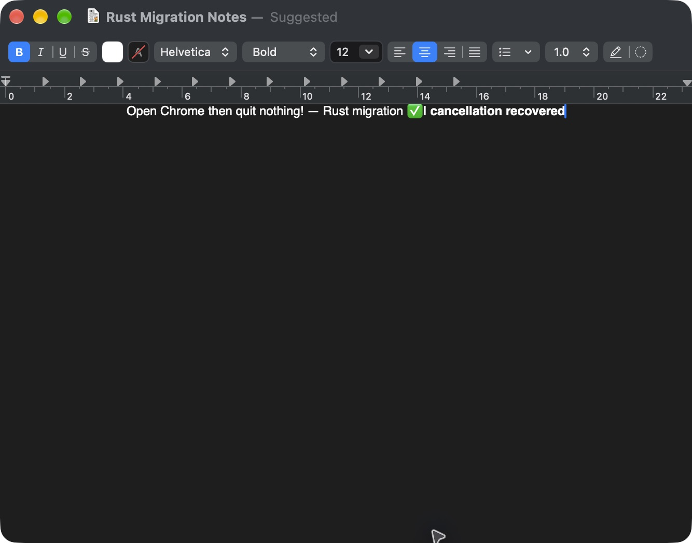

# Mac desktop E2E — 2026-10-29

Host: Apple M4 / Mac16,12, 16 GiB, macOS 27.0.1 (26A434). App: workspace `target/release/bundle/macos/FnPilot Preview.app`, identifier `com.fnpilot.preview`. This is local development verification of the uncommitted migration, not release acceptance.

Final executable SHA-256: `86398ba5a8de82452c28bb553968cad4cc3c2ca4baa4afe72cab40d47781b363`.

| Path | Evidence |
|---|---|
| Permissions | Accessibility, Input Monitoring and Microphone report true after the final native rebuild. User approved each grant and local Apple Development signing; subsequent changed builds preserve grants. Deep/strict signature verification passes |
| Physical voice | User physically held Fn, spoke the synthetic Calculator command, released, and reported Listening → Transcribing → Done. App independently reported observed success. This check preceded the window-only corrections |
| Activation and typing | Calculator/TextEdit open and focus exercised. A new TextEdit fixture contains the exact literal punctuation, Unicode and command-like words; no embedded instruction was executed |
| Window state | Minimize completes with observed success. Final candidate maximize and exact saved-frame restore both report observed success. Fixes poll transitions, repeat resize after moving, reapply position after centered resize, and allow bounded system chrome insets only for maximize |
| Visible controls | Explicitly focusing TextEdit then clicking align centre changes centre from 0 to 1 and left to 0. Independent TextEdit AX inspection confirms the effect. A successful scan visits 58 nodes / 24 controls; malformed/truncated scans fail closed |
| Cancellation | Cancel during a long focus sequence returns Ready/Cancelled; subsequent literal typing succeeds and is visible in the fixture |
| Settings | Pause/resume, rejected remote endpoint, reviewed legacy import and pending microphone approval feedback exercised. Legacy preferences/caches preserved |
| Inference helper | GUI Start/health/Stop with existing local GGUF succeeds. Owned listener disappears and port rebind succeeds; unrelated Ollama service remains running. Model actions remain explicitly disabled |
| Automated checks | 37 Rust tests pass / 1 decoder test ignored by default; 5 UI tests; 6 Python tests; TypeScript, formatting, Clippy and Windows platform/runtime cross-Clippy pass. Swift: 2 pass / 1 opt-in real-decoder test skipped by default. Real offline speech and packaged helper smoke evidence is retained in the local verification receipt |

The older running Swift application was quit through Activity Monitor to avoid competing hotkey listeners. Production Swift is now only the 92-line WhisperKit binding. New desktop features belong in Rust/Tauri.

No model downloads, installed-app replacements, publication or official release occurred. The workspace Preview is left running; its owned helper is stopped and can be started on demand. The agent-created TextEdit fixture was retained for inspection.

Physical Escape/chord interception was not established by synthetic input; Cancel was verified directly. Lock/sleep, permission revocation/device changes, exhaustive overlay-focus behavior, minimum macOS 14, native Windows and performance/distribution qualification remain pending. These results establish the selected local development paths only.

